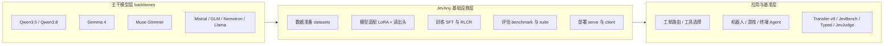
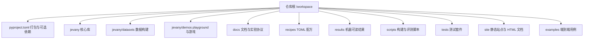
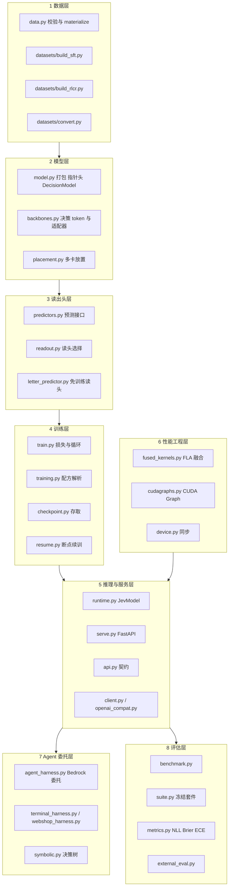
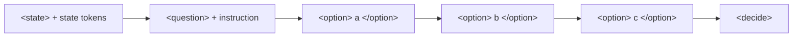
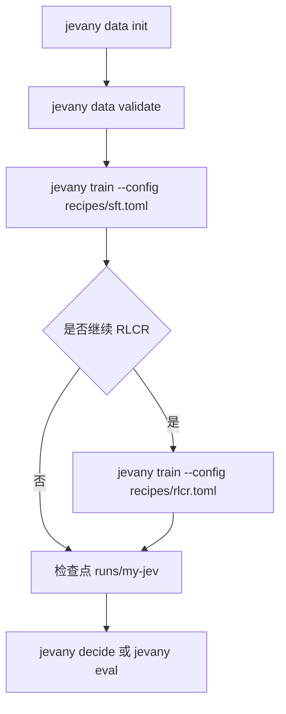
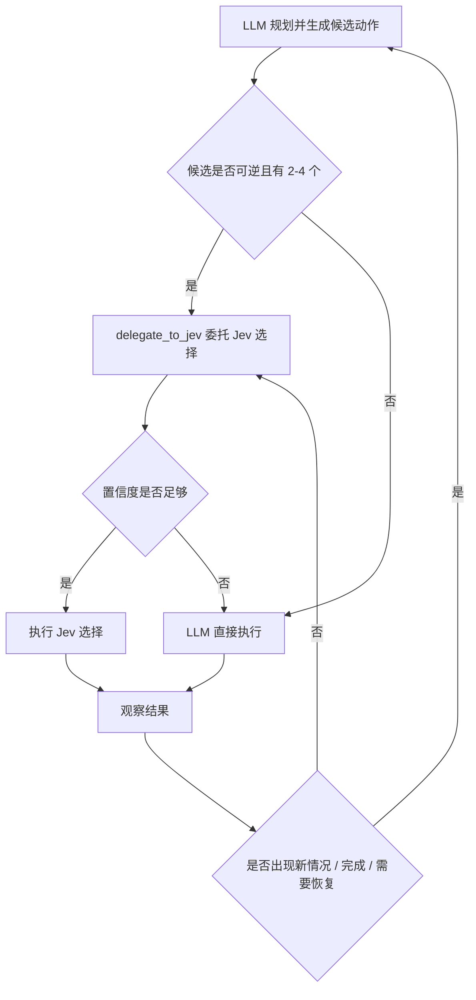

# 整体观 · JevAny 项目全貌解读

> 三观递进之一 —— **看见（Bird's-eye View）**
> 本文是三篇解读的第一篇。它不深入某一个损失函数或某一个 kernel，而是带你站到高处，回答三个问题：**JevAny 是什么？它在整个决策模型生态里站在哪里？它的代码是如何组织并跑起来的？**
> 读完本文，你应当能拿到一张完整的"项目认知地图"；随后请继续阅读《具体观》与《深刻观》，地图上的每个坐标会被逐一填满。

---

## 一、总述：一句话、一段话与一个命题

**一句话**：JevAny 是一套面向 **System 1 决策模型** 的开源基础设施（open infra），覆盖**数据准备、模型适配、训练、评估与部署**的全流程，让你"从任意主干模型，得到任意应用里的决策能力"。

**一段话**：传统的 LLM 擅长"推理（System 2）"——规划、写代码、写文章；但当系统只需要在**有限候选**中做一次**选择**时（把工单路由到哪个部门、机器人下一步往哪走、终端里先跑哪条命令），再让 LLM 生成一大段文本再解析答案，既慢又贵，而且置信度难以校准。JevAny 把这类"选择"从"推理"中**剥离**出来，做成一个**廉价的、单次前向的、返回可校准概率的**决策模型。它复用任意现成的主干模型（Qwen / Gemma / Muse / Mistral / GLM / Nemotron / Llama 等 26 个模型族），用轻量 LoRA 与一个小型"读出头"完成适配，对外则只暴露**一个统一契约**：给 `state` 与若干带候选的**定型问题**，直接返回**选择 + 概率**。

**一个命题**：JevAny 的自我定位写在仓库第一屏（[README.md](file:///workspace/README.md#L25-L29)）——

> *"JevAny is open infra for **System 1 decision model** training and deployment"*

这七个单词里的关键词是 **System 1**。它不是又一个聊天模型项目，而是一个**把不确定的世界压缩成"可比较、可校准、可委派"的选择分布**的通用接口。理解这一点，是理解后续所有代码取舍的钥匙。

本文的组织遵循**总分总**：先总述（本节）→ 分五层递进展开（生态定位 → 代码结构 → 设计理念 → 实现原理 → 整体流程）→ 最后收束成一段"整体画像"，并以一节**使用指南与案例**承接实践。

---

## 二、生态定位：它站在哪里

### 2.1 生态的三层结构

要理解 JevAny，先要理解"决策模型"这个细分生态的三层结构：**底层是主干模型（backbones）**，**中层是决策适配与基础设施（JevAny 所在层）**，**上层是应用与评测基准**。JevAny 并不重新发明主干模型，它的价值在于：**把任意主干"改造成"决策模型，并且训推一体、可复现、低延迟。**

下面这张图展示了这个生态站位。



*图 1：JevAny 的生态定位图。它位于"主干模型"与"应用"之间，是**适配与基础设施层**：向下复用任意主干（不训练主干），向上对应用只暴露一个决策 API，向右支撑基准评测。这张图说明为什么 JevAny 的代码里看不到任何"从零训练大模型"的部分——它的核心工作是把已有能力重新组织成"选择"。*

### 2.2 与同类项目的相对位置

在同一生态位里，还有若干可比对象。理解它们的差异，能更精确地定位 JevAny。依据仓库自身给出的评测表（[EVALUATION.md](file:///workspace/docs/EVALUATION.md#L22-L33) 与 [EFFICIENCY.md](file:///workspace/docs/EFFICIENCY.md#L40-L44)）：

| 对象 | 定位 | 与 JevAny 的关系 |
|---|---|---|
| **Kev**（jaredpalmer/kev） | 早期决策模型 / 评测套件 | JevAny 的代码派生来源之一（见 [NOTICE](file:///workspace/NOTICE) 与 [model.py](file:///workspace/jevany/model.py#L1-L2) 头注释）；Transfer-v9 套件亦源自 Kev |
| **TypeSafe Jev** | 商业化托管的决策 API | JevAny 在**文本契约层**对齐其 HTTP API / Python SDK，可用官方 SDK 直连本地服务器（[API.md](file:///workspace/docs/API.md#L98-L106)） |
| **Laya**（ModernBERT 系） | 轻量决策基线 | 无 Gated DeltaNet 层，故推理加速项对其不适用 |
| **decider / Intern-Decision / Open-Jev** | 其他决策模型 | 在同硬件同面板下对比（[EFFICIENCY.md](file:///workspace/docs/EFFICIENCY.md#L94-L111)） |

> 关键观察：JevAny 既不与主干模型竞争，也不与托管 API 竞争——它竞争的是**"把决策能力工程化"这件事本身**：可训练（SFT/RLCR）、可适配（LoRA + 可换读出头）、可评测（冻结套件 + 机器可读结果）、可部署（本地 Python + HTTP + OpenAI 兼容 + Bedrock Agent 委托）。

### 2.3 "从任意模型到任意应用"的两端

- **"From Any Model"（任意主干）**：仓库支持 26 个模型族、7 个维护中的家族（[DEPLOYMENT.md](file:///workspace/docs/DEPLOYMENT.md#L612-L618)），并通过 `BackboneAdapter` 可扩展自定义主干（[TRAINING.md](file:///workspace/docs/TRAINING.md#backbone-support)）。
- **"To Any Application"（任意应用）**：仓库自带 30 个归档案例，覆盖机器人装配、实验室自动化、仓储、驾驶、浏览器工作、SQL 修复等（[CASES.md](file:///workspace/docs/CASES.md)），并提供 playground 把模型接进 FrozenLake / Sokoban / Doom / Crafter / Franka 机械臂。

---

## 三、整体代码结构：一张目录与八层职责

### 3.1 顶层结构

仓库的顶层目录可以分为"可运行库 + 文档 + 数据与结果 + 站点"四类。下图为目录树（只展开关键节点）。



*图 2：JevAny 顶层目录结构树。核心可复用代码集中在 `jevany/`，其余目录分别承载"文档 / 配方 / 结果 / 脚本 / 测试 / 站点 / 用例"六类配套。这张图回答"代码在哪里"，下一张图回答"职责如何分层"。*

### 3.2 八层职责模型

把核心库 `jevany/` 下的约 45 个模块按职责归纳，可以得到清晰的**八层结构**。这是理解整个项目最有用的一张地图。



*图 3：JevAny 的八层职责模型。数据层产出训练/评测记录 → 模型层完成"state + 候选问题"的编码与读头计算 → 读出头层决定"如何把隐状态变成概率" → 训练层负责 SFT/RLCR 与检查点 → 推理服务层对外暴露统一契约 → 性能工程层横向加速推理 → Agent 委托层把 Jev 嵌入 LLM 循环 → 评估层用冻结套件量化。这张图是理解模块依赖关系的骨架。*

### 3.3 关键模块速查

| 模块 | 职责 | 关键符号 |
|---|---|---|
| [model.py](file:///workspace/jevany/model.py) | 决策 token 打包、指针头、掩码、`DecisionModel` | `encode()`、`PointerHead`、`branch_mask_batch()` |
| [backbones.py](file:///workspace/jevany/backbones.py) | 5 个决策 token 定义、主干适配器 | `decision_tokens()`、`prepare_tokenizer()` |
| [train.py](file:///workspace/jevany/train.py) | 损失函数与训练循环 | `question_loss`、`lm_token_loss`、`rlcr_question_loss` |
| [training.py](file:///workspace/jevany/training.py) | TOML 配方解析与 Python 入口 | `train()`、`configure_parser()` |
| [runtime.py](file:///workspace/jevany/runtime.py) | 进程内推理运行时 | `JevModel.from_pretrained()` |
| [serve.py](file:///workspace/jevany/serve.py) | FastAPI 服务 | `POST /v1/systemone`、`GET /v1/models` |
| [cudagraphs.py](file:///workspace/jevany/cudagraphs.py) | 分桶 CUDA Graph | `RowGraphs`、`LENGTHS` |
| [fused_kernels.py](file:///workspace/jevany/fused_kernels.py) | Qwen3.5 融合 kernel | `fuse_qwen3_5()` |
| [agent_harness.py](file:///workspace/jevany/agent_harness.py) | LLM Agent 委托 | `BedrockJevAgent`、`delegate()` |
| [benchmark.py](file:///workspace/jevany/benchmark.py) | 评测流程 | `LocalPredictor`、`RemotePredictor` |

---

## 四、设计理念：四条不可动摇的原则

代码结构背后是四条贯穿全项目的设计理念。它们是理解"为什么这样写"的判据。

### 4.1 原则一：候选约束，而非自回归生成

JevAny **从不生成答案字符串**。它在 `<decide>` 位置直接对**显式给出的候选集**打分（[ALGORITHM.md](file:///workspace/docs/ALGORITHM.md#L5-L7)："It does not decode an answer string."）。这带来三个直接好处：
1. **候选边界不可伪造**——调用者传入的文本会被安全转义，绝不会伪造出分隔符（[model.py `safe_text`](file:///workspace/jevany/model.py#L81-L91)）。
2. **答案空间有界**——指针头支持最多 4,096 个候选，direct-token 支持 255 个（[README.md](file:///workspace/README.md#L280-L283)）。
3. **置换不变性可构造**——选项顺序不影响结果（见第五节的 `option_isolation`）。

### 4.2 原则二：统一契约贯通"训与推"

训练时用的数据格式与推理时发送的请求**是同一套**（`state` + `questions`），差别仅在于训练记录额外带 `label` 或软目标 `target`（[API.md](file:///workspace/docs/API.md#L128-L136)）。"训练所见即推理所用"消除了训推偏移的一大来源。适配器、tokenizer、决策 token、分支布局在训练与部署时**解析同一份保存记录**（[DEPLOYMENT.md](file:///workspace/docs/DEPLOYMENT.md#L6-L8)）。

### 4.3 原则三：概率是一等公民，可校准优先

每个回答都返回**完整概率分布**，而不只是一个标签。校准（calibration）被当作第一等指标：仓库不仅报告准确率，还报告 **NLL / Brier / ECE**（[EVALUATION.md](file:///workspace/docs/EVALUATION.md#L22-L33)）。而且明确区分两类操作——
- **温度缩放**：改变置信度，**不改变**被选答案（[ALGORITHM.md](file:///workspace/docs/ALGORITHM.md#L31-L33)）；
- **choice-token 读头**：可以**改变**被选答案（[CHOICE_READOUT.md](file:///workspace/docs/CHOICE_READOUT.md#L14-L17)）。

这种"把改变置信度与改变答案分开"的克制，正是"可校准优先"的直接体现。

### 4.4 原则四：委托选择，而非委托任务

面向 Agent 场景，JevAny 定下一条**黄金法则**："Delegate the selection bottleneck, not the task."（[README.md](file:///workspace/README.md#L57-L69)）LLM 仍然负责规划、生成候选、异常恢复与最终验证；Jev 只在**有界的、可逆的**候选上做选择。这条法则把 Jev 的适用边界写死在文档里，避免"为了用而用"。

---

## 五、实现原理概述：三件事把主干变成决策器

原理层面，JevAny 只做了三件事。更深的算法与论文依据留给《具体观》，这里给出骨架。

### 5.1 事一：用 5 个分隔 token 表达"结构化决策"

主干模型原本只会读自然语言。JevAny 在 tokenizer 中定义/复用了 **5 个决策分隔符**：

```
<|jev_state|>  <|jev_question|>  <|jev_option|>  <|jev_end_option|>  <|jev_decide|>
```

（[backbones.py](file:///workspace/jevany/backbones.py#L20-L66)；优先复用主干中"罕用的现存特殊 token"，从而**不新增 embedding 行**，由 LoRA 赋予新语义。）

### 5.2 事二：把一次请求打包成"一段 state + 若干问题分支"

`encode()` 把一条记录打包成：

```text
<state> state
<question> instruction <option> a </option> ... <decide>
```

并产出四个关键索引：`seg`（token 属于哪一段）、`pos`（位置）、`opt`（token 属于哪个选项）、`decide_idx` / `opt_idx`（`<decide>` 与各选项末 token 的绝对位置）。下图展示这一布局。



*图 4：一次决策的 token 打包布局。共享的 state 在前，随后是问题分支：instruction 描述"要决定什么"，每个选项用 `<option>...</option>` 包裹，最后落在 `<decide>` 上。模型不在此处"续写文字"，而是用 `<decide>` 处的隐状态去对每个选项末 token 的隐状态打分。这张图是理解"为什么它不生成文本"的关键。*

### 5.3 事三：用"读出头"把隐状态变成概率

在 `<decide>` 处，有两种读出头（readout）把隐状态转成候选概率：
- **指针头（Pointer）**：`<decide>` 的隐状态作 query，各选项末 token 作 key，输出每选项一个 logit（[model.py](file:///workspace/jevany/model.py#L263-L286)）；
- **direct-token**：给候选分配固定单 token 标签，直接取冻结 LM 头对应 logits 并在候选上归一化（[ALGORITHM.md](file:///workspace/docs/ALGORITHM.md#L35-L37)）。

三者合起来，就是"把任意主干变成决策器"的全部秘诀。

---

## 六、整体流程：三条端到端主线

理解一个基础设施，最有效的方式是看它**端到端怎么跑**。JevAny 有三条主线：训练链、推理/服务链、Agent 委托链。它们都由同一套契约串联。

### 6.1 训练链：从数据到检查点



*图 5：训练链端到端流程。数据先初始化与校验，再用 SFT 配方训练 LoRA 适配器，可选地以 RLCR 续训，产出可推理、可评测的检查点。这条链路对应 CLI 的 `data / train / decide / eval` 四个子命令（[cli.py](file:///workspace/jevany/cli.py#L8-L39)）。*

### 6.2 推理/服务链：一次请求的生命周期

```
客户端 JevClient.system_one(state, questions)
        │  HTTP POST /v1/systemone
        ▼
serve.py  create_app  →  api.py  SystemOneRequest 校验
        │
        ▼
runtime.py  JevModel：加锁 → encode() → 前向 → 读头 → 概率
        │
        ▼
响应 { model, answers, usage: {input_tokens, output_tokens} }
```

关键点：**单次 prefill**即可完成决策，不进入自回归解码循环；服务端为**单模型**服务，未知 model 返回 422（[API.md](file:///workspace/docs/API.md#L64-L68)）。

### 6.3 Agent 委托链：把 Jev 嵌入 LLM 循环



*图 6：Agent 委托链。LLM 负责"生成有界候选"，Jev 负责"在候选中选择"，低置信度或出现新情况时**把控制权交还 LLM**。这条链路与"委托阶梯 D0–D4"和"任务层级 T0–T4"两套协议绑定（[AGENT_HARNESS_FRONTIER_PROTOCOL.md](file:///workspace/docs/experiments/AGENT_HARNESS_FRONTIER_PROTOCOL.md)），也是《深刻观》将要升华的核心。*

### 6.4 三条链路的共同骨架

把三条链路叠在一起看，会发现它们共享同一个骨架：

```
数据契约（state + questions）  →  模型编码（token 打包）  →  读头（概率）  →  下游消费者（应用 / 评测 / Agent）
```

这正是"统一契约"的价值：训练、评测、服务、Agent 委托，全都建立在这条同构的骨架上。

---

## 七、总结：整体画像

**JevAny 是一个把"决策"从"推理"中剥离出来的基础设施。** 它不训练主干，而是用 5 个分隔 token + 一个轻量读出头把任意主干改造成决策器；它用 `state + questions` 这一个契约贯通训练与推理；它把概率当作一等公民，把"改变置信度"与"改变答案"严格分开；它把"委托选择而非委托任务"写成黄金法则；它还在单 batch 推理路径上做了极致工程（融合 kernel + CUDA Graph）。**它的目标不是更聪明，而是更便宜、更可校准、更可委派地做选择。**

拿到这张地图后，请继续阅读：

- 《具体观 · 算法与实现剖析》——把本文提到的每个技术点拆开，给出公式、论文依据与代码例证；
- 《深刻观 · 哲学与升华》——回答"为什么会是这样一套设计"，并以两三句话收束。

---

## 附录 · 使用指南与案例（快速上手）

> 本节是"整体观"的落地部分：给你一套**可复制**的最小闭环命令，以及三个真实案例。所有命令与字段均取自仓库自带的文档与示例文件。

### A.1 安装与环境

```bash
git clone https://github.com/SimpleJev/JevAny.git
cd JevAny
python3.12 -m venv .venv
source .venv/bin/activate
python -m pip install -e .          # 仅 schema / HTTP 客户端 / 数据工具，无 PyTorch
```

按需安装可选依赖（[pyproject.toml](file:///workspace/pyproject.toml#L31-L60)）：

| 目标 | 命令 |
|---|---|
| 本地加载模型 | `pip install -e '.[local]'` |
| 训练 | `pip install -e '.[train]'` |
| 部署（FastAPI/HTTP） | `pip install -e '.[serve]'` |
| 图像/视频 | `pip install -e '.[multimodal]'` |
| 融合 kernel 加速 | `pip install -e '.[fast]'` |
| playground 游戏/机器人 | `pip install -e '.[demo]'` / `.[robotics]'` |

### A.2 最小闭环四步（合成工单数据）

```bash
# 1. 生成起步数据（合成客服工单）并校验
jevany data init --out data/starter
jevany data validate data/starter/train.jsonl

# 2. 先 dry-run 检查配方，再真正训练（默认 Qwen3.5-0.8B + BF16）
jevany train --config recipes/sft.toml --dry-run
jevany train --config recipes/sft.toml

# 3. 用刚训练的检查点跑一条真实请求
jevany decide examples/request.json --checkpoint runs/my-jev
```

请求文件 [examples/request.json](file:///workspace/examples/request.json) 形如：

```json
{
  "model": "jevany-latest",
  "state": "I was charged twice.",
  "questions": {
    "department": {
      "type": "choice",
      "instructions": "Which team should handle this?",
      "criteria": {"billing": "Payment problems", "shipping": "Delivery problems"}
    }
  }
}
```

三种问题类型与回答字段（[API.md](file:///workspace/docs/API.md#L24-L36)）：

| 类型 | 必填 criteria | 回答字段 |
|---|---|---|
| `choice` | 选项名 → 描述 的映射 | `type`、`choice`、`probabilities`、`confidence` |
| `noul`（yes/no） | 可选 true/false 描述 | `type`、`noul`（为 true 的概率） |
| `score`（有序等级） | 有序等级描述 | `type`、`score`、`legend`、`probabilities`、`confidence` |

### A.3 案例一：把模型跑成服务，再用 Python 客户端请求

```bash
# 终端 A：启动单模型服务
python -m pip install -e '.[serve,multimodal]'
jevany serve --checkpoint SimpleJev/JevAny-Qwen3.5-4B-LoRA \
  --device cuda --dtype bf16 --port 8008

# 终端 B：等待就绪后，用一个真实工单请求
curl -sf http://127.0.0.1:8008/health
jevany decide examples/request.json --base-url http://127.0.0.1:8008
```

```python
# 进程内客户端用法（与 HTTP 共用同一契约）
from jevany import Choice, JevClient

jev = JevClient("http://127.0.0.1:8008")
result = jev.system_one(
    state={"ticket": "I was charged twice. Please help."},
    questions={
        "department": Choice(
            instructions="Which team should handle this?",
            criteria={"billing": "Payment problems", "shipping": "Delivery problems"},
        ),
    },
)
answer = result["answers"]["department"]
print("Selected team:", answer["choice"])
print("Probabilities:", answer["probabilities"])
```

这是最典型的**工单路由**案例：应用读取 `choice` 决定路由，读取 `probabilities` 决定是否需要人工复核。

### A.4 案例二：免训练读头与评测（不改掷测头的答案也可以换路径）

```bash
# 用训练无关的 choice-token 读头评测一个冻结主干或已有检查点
jevany eval --run SimpleJev/JevAny-Qwen3.5-4B-Direct-Token-LoRA \
  --suite /path/to/suite --out runs/choice --device cuda --readout choice
```

其余可复现实验（残差头消融、direct-token 基线、RLCR 续训、自定义损失）将在《具体观》的附录中按技术点逐一给出。

### A.5 案例三：Playground 里的机器人与游戏

```bash
# 启动 playground（可与上面的服务配合）
jevany demo --base-url http://127.0.0.1:8008 --text-only
```

打开 `http://127.0.0.1:8090`，在模型面板填入 `http://127.0.0.1:8008` 并点 **Test and connect**，即可：
- 在 **Try your own decision** 里改 state / 候选，观察决策与概率如何变化；
- 让模型接管 **FrozenLake / Doom / Crafter / Franka 机械臂**（归档回放见 [CASES.md](file:///workspace/docs/CASES.md)）。

---

*（本文为三观递进之一·整体观。校验说明：本文全部 Mermaid 图已通过语法校验，见文末《校验记录》一节。本文所有数字与引用均来自仓库内真实文件。)*

---

## 校验记录

| 图 | 类型 | 状态 |
|---|---|---|
| 图 1 生态定位图 | `flowchart LR` | 通过 |
| 图 2 目录结构树 | `flowchart TB` | 通过 |
| 图 3 八层职责模型 | `flowchart TB` + `subgraph` | 通过 |
| 图 4 决策打包布局 | `flowchart LR` | 通过 |
| 图 5 训练链流程 | `flowchart TD` | 通过 |
| 图 6 Agent 委托链 | `flowchart TD` | 通过 |
