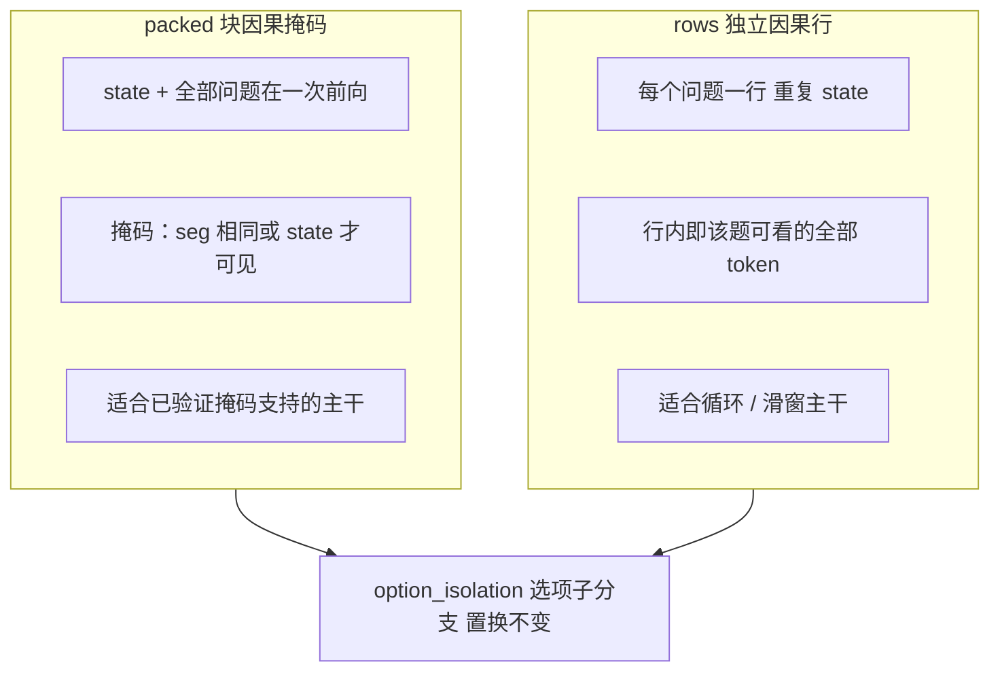
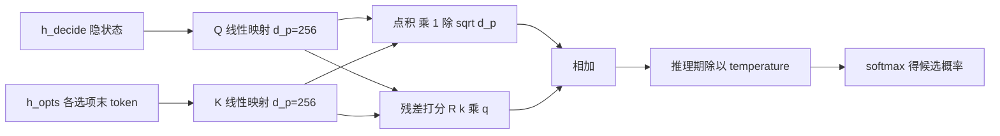
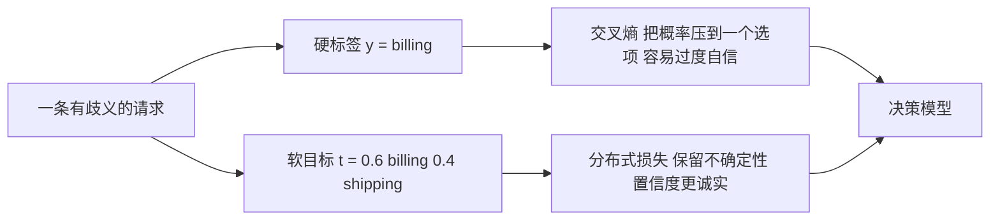
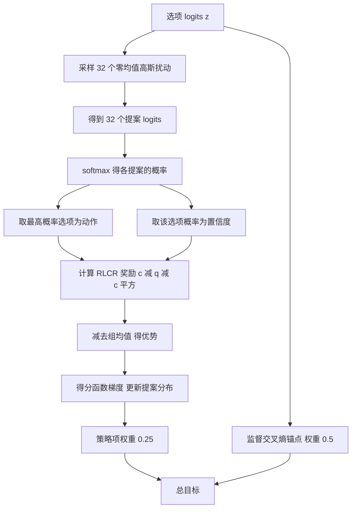
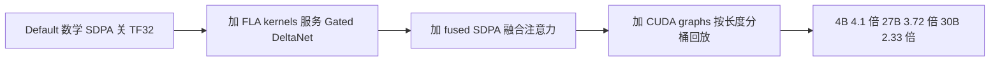
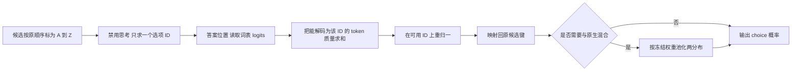

# 具体观 · 算法与实现剖析

> 三观递进之二 —— **看懂（Deep Dive）**
> 《整体观》给了你一张地图；本文带你**潜到水下**，把地图上最值得深挖的 6 个技术点逐一拆开：**每个点都是"学术原理（附论文）→ 代码实现（附行号）→ 具象例子"三段式**。
> 读完本文，你应当能真正理解 JevAny 的算法内核，并能自己动手复现实验。

---

## 一、总述：为什么是这 6 个技术点

JevAny 的技术含量集中在 6 个点上，它们恰好构成"一个决策请求从进到出"的完整链路：

| 序号 | 技术点 | 一句话原理 | 对应代码 |
|---|---|---|---|
| 1 | **决策重构**：候选打分而非生成 | 把"生成答案串"变成"对候选集打分" | [model.py](file:///workspace/jevany/model.py#L97-L135) |
| 2 | **指针头与残差打分** | 用 `<decide>` 隐状态作 query 对选项 key 打分 | [model.py](file:///workspace/jevany/model.py#L263-L286) |
| 3 | **direct-token 读头** | 把候选映射为单 token 标签，取 LM 头 logits | [model.py](file:///workspace/jevany/model.py#L481-L493) |
| 4 | **SFT：硬标签与软目标** | 软目标把"歧义"编码为分布 | [train.py](file:///workspace/jevany/train.py#L28-L51) |
| 5 | **RLCR：校准奖励的策略梯度** | 奖励 = 正确性 + Brier 项，组内相对优势 | [train.py](file:///workspace/jevany/train.py#L54-L85) |
| 6 | **推理加速：融合 kernel + CUDA Graph** | 把长串小 kernel 合并 + 用图消除启动开销 | [fused_kernels.py](file:///workspace/jevany/fused_kernels.py)、[cudagraphs.py](file:///workspace/jevany/cudagraphs.py) |

它们的关系可以这样理解：**1 定义了"问题的形状"，2 与 3 是"两种把隐状态变成概率的方法"，4 与 5 是"两种训练目标"，6 是"把前五步跑得更快"**。前五个决定"对不对、准不准"，第六个决定"快不快"。这也是 JevAny 的核心追求——**低延迟 + 可校准 + 可控候选**。

本文按"分述"依次展开 6 个点，每点附**至少一篇真实学术论文**；最后"总结"回到全局，并附一节**使用指南与案例**（按技术点组织的可复现实验）。

---

## 二、技术点 1：决策重构 —— 从"生成答案串"到"候选打分"

### 2.1 原理与论文

主流 LLM 回答选择题的方式是**生成文本再解析**："答案应该是 B，因为……"，然后从文本里抽取 "B"。这有两个结构性缺陷：（a）**答案空间不受约束**，模型可能输出非法选项；（b）**概率信息被丢失**，文本里没有可校准的置信度。

JevAny 的选择是：**不生成，只打分**。它把问题重新表述为一个**受约束的多分类问题**——在显式给出的候选集上输出一个归一化分布。这与"序列打包（packed sequence）+ 块因果掩码（block-causal mask）"的高效注意力训练范式直接相关：

> [Attention Is All You Need](https://arxiv.org/abs/1706.03762) — Vaswani et al., 2017：提出缩放点积注意力，是全篇打分机制的理论地基。
> [FlashAttention: Fast and Memory-Efficient Exact Attention with IO-Awareness](https://arxiv.org/abs/2205.14135) — Dao et al., 2022：证明注意力可通过 IO 感知的分块实现加速，JevAny 的 `fused SDPA` 与序列打包正是这一思路的工程延伸。

### 2.2 代码实现

`encode()` 是"问题形状"的定义者（[model.py](file:///workspace/jevany/model.py#L97-L135)）。它的布局是：

```text
<state> state
<question> instruction <option> a </option> ... <decide>
```

它返回 6 个关键量：

| 字段 | 含义 |
|---|---|
| `ids` | 拼接后的 token 序列 |
| `seg` | 每个 token 属于哪一段（0 = state，k = 第 k 个问题） |
| `pos` | 位置 id（分支位置在 state 之后重新计数） |
| `opt` | 每个 token 属于该问题的哪个选项（`OPT_NONE=-1`、`OPT_DECIDE=-2`） |
| `decide_idx` | 各问题 `<decide>` 的绝对位置 |
| `opt_idx` | 各问题每个选项**末 token**（`</option>`）的绝对位置 |

有两个安全设计值得单独指出：
- **候选边界不可伪造**：`user_tokens()` / `safe_text()` 在 tokenize 前把用户文本里的 `<|...|>` 改写为 `<¦...¦>`，确保调用者的输入**永远不会**伪造出分隔符（[model.py](file:///workspace/jevany/model.py#L81-L91)）。
- **两种分支模式**：`packed`（把一条记录所有问题放进一次前向，用块因果掩码隔离）与 `rows`（每个问题一条独立因果行、重复 state）。后者用于**循环/滑窗类主干**（Qwen3.5/3.8 的 Gated DeltaNet），因为这类架构没有经过验证的打包掩码支持。选择逻辑在 `DecisionModel.__init__`（[model.py](file:///workspace/jevany/model.py#L321-L329)）。

### 2.3 具象例子：`option_isolation` 的置换不变性

选项顺序不应影响决策结果——否则模型可能学到"位置偏置"。JevAny 用 `option_isolation` 从结构上保证这一点（[model.py](file:///workspace/jevany/model.py#L104-L106)、掩码实现见 [model.py](file:///workspace/jevany/model.py#L217-L243)）：

- 每个选项 span 成为**独立子分支**：只能看到 state、instruction 与自己；
- 所有选项 span **共享相同的位置 id**；
- `<decide>` 位于最长 span 之后的**固定位置**，可看到整题。

于是"每个选项的表示"与"`<decide>` 对它们的注意力"**天然置换不变**。下图对比两种分支模式。



*图 1：两种分支模式与选项隔离。左边是 packed 模式（一次前向 + 块因果掩码），右边是 rows 模式（每题一行、重复 state）；两者都能再叠加 `option_isolation`，把每个选项变成独立子分支以获得置换不变性。这张图解释了"为什么同一个决策模型要准备两套分支布局"。*

---

## 三、技术点 2：指针头（PointerHead）与零初始化残差打分

### 3.1 原理与论文

指针头把"选择"建模成一次注意力打分：用 `<decide>` 位置的隐状态作 **query**，用每个选项末 token 的隐状态作 **key**，点积得到每个选项的分数。这套机制直接继承自缩放点积注意力：

> [Attention Is All You Need](https://arxiv.org/abs/1706.03762) — Vaswani et al., 2017：定义 "query-key 点积 + 缩放 + softmax" 这一基本算子。

而"温度缩放改变置信度但不改变 argmax"这一性质，来自校准文献：

> [On Calibration of Modern Neural Networks](https://arxiv.org/abs/1706.04599) — Guo et al., 2017：提出温度缩放（temperature scaling），用单一标量在验证集上拟合以改善置信度校准，且**不改变预测类别**。

### 3.2 代码实现

指针头的实现只有十几行（[model.py](file:///workspace/jevany/model.py#L263-L286)）：

```python
class PointerHead(nn.Module):
    def __init__(self, d, dp=256, residual_dim=0):
        self.q, self.k = nn.Linear(d, dp), nn.Linear(d, dp)
        self.scale = 1 / math.sqrt(dp)
        self.residual = nn.Sequential(
            nn.Linear(dp, residual_dim), nn.GELU(), nn.Linear(residual_dim, 1),
        )   # 输出层零初始化
        nn.init.zeros_(self.residual[-1].weight)
        nn.init.zeros_(self.residual[-1].bias)

    def forward(self, h_decide, h_opts):
        query, options = self.q(h_decide), self.k(h_opts)
        z = (options @ query) * self.scale
        if self.residual is not None:
            z = z + self.residual(options * query.unsqueeze(0)).squeeze(-1)
        return z if self.training or self.temperature == 1.0 else z / self.temperature
```

数学上，令 `h_d` 为 `<decide>` 隐状态、`h_i` 为第 i 个选项末 token 隐状态：

```text
q = Q(h_d),  k_i = K(h_i)
z_i = k_i · q / sqrt(d_p) + R(k_i * q)
p_i = softmax(z)_i
```

其中 `d_p = 256`，`*` 为逐元素乘，`R` 为 256 宽 `Linear/GELU/Linear` 的残差打分器（[ALGORITHM.md](file:///workspace/docs/ALGORITHM.md#L21-L33)）。

**三个精心设计的细节：**
1. **零初始化残差层**：训练开始时 `R` 输出恒为 0，整个帽子退化为纯点积——相当于"从已知安全的基线起步"，再由训练逐步引入非线性。这是残差分支常见的稳健初始化手法（如 LoRA 的 B 矩阵零初始化）。
2. **temperature 只在推理期生效**：`self.training` 时永远用 T=1，因此训练得到的参数在换成任意拟合温度后依然有意义；且因为是**整体除以正标量**，argmax 天然不变。
3. **标量只拟合一次**：温度由 `scripts/calibrate_checkpoint.py` 在**独立的校准分区**上拟合并写入 `head.pt`（[model.py](file:///workspace/jevany/model.py#L276-L279)）。

### 3.3 具象例子

`_question_readout()` 展示了指针头的调用方式（[model.py](file:///workspace/jevany/model.py#L491-L493)）：

```python
indices = torch.tensor([decide, *options], device=h.device, dtype=torch.long)
selected = h.index_select(0, indices).to(..., dtype=torch.float32)
return self.head(selected[0], selected[1:])     # selected[0] = h_decide, selected[1:] = h_opts
```

注意它只 `index_select` 出需要的 token 向量，再交给头——**不为不相关的 token 做无用计算**，这是单 batch 推理路径上的常见优化。

下图展示指针头的数据流。



*图 2：指针头计算图。虚线式地可以读作：`<decide>` 的隐状态过 Q 得到 query，选项隐状态过 K 得到 keys，二者点积缩放后，再叠加一条"逐元素乘 → 残差网络"的非线性通路；最后经温度缩放与 softmax 得到候选概率。这张图说明"选择"是如何被表示成一次注意力打分的。*

---

## 四、技术点 3：direct-token 读头与"单 token 往返"的 verbalizer

### 4.1 原理与论文

指针头需要**训练一个额外的头**。但还有一条更轻的路径：**直接借用主干自己的语言模型头**。做法是给每个候选分配一个**固定的、唯一的、单 token** 标签（verbalizer），在 `<decide>` 处直接读取这些标签对应的 logits。

这条路线的思想根源是"用**软标签分布**而非硬标签来监督分类头"：

> [Distilling the Knowledge in a Neural Network](https://arxiv.org/abs/1503.02531) — Hinton et al., 2015：提出用教师的软分布作为训练目标，说明"分布"比"硬标签"携带更多信息，是理解 direct-token 与软目标 SFT 的共同背景。

### 4.2 代码实现

verbalizer 的选取极其苛刻（[model.py](file:///workspace/jevany/model.py#L39-L75)）：

```python
BASE_VERBALIZERS = "ABCDEFGHIJKLMNOPQRSTUVWXYZabcdefghijklmnopqrstuvwxyz0123456789"
MAX_DECISION_OPTIONS = 255

def decision_verbalizers(tok, count=MAX_DECISION_OPTIONS):
    """Return deterministic, distinct, round-tripping single-token option labels."""
    def admit(symbol):
        ids = tok(symbol, add_special_tokens=False).input_ids
        if len(ids) == 1 and ids[0] not in token_ids and tok.decode(ids) == symbol:
            symbols.append(symbol); token_ids.add(ids[0])
    for symbol in BASE_VERBALIZERS:
        admit(symbol)
    for codepoint in range(0x00A1, 0xA000):   # 不够时扫描 Unicode 可打印字符
        ...
```

三个约束缺一不可：**必须是单 token**（否则无法"读取一个位置"）、**必须唯一**（token id 不能重复）、**必须可往返**（`decode(encode(s)) == s`，保证标签无歧义）。前 62 个用 `A–Z,a–z,0–9`，不足时按码点扫描 Unicode 补充，上限 255。

推理期的关键差异（[model.py](file:///workspace/jevany/model.py#L481-L490)）：

```python
if not self.training:
    # 推理只在候选上归一化：先选出候选行，避免给整个词表算分
    weight = weight.index_select(0, self._verbalizer_index[:len(options)])
logits = F.linear(query.to(weight.device, weight.dtype), weight).float()
```

而训练期（`lm_token_loss`）**用完整词表做分母**（[train.py](file:///workspace/jevany/train.py#L37-L51)）。为什么？——训练时保持"全词表 next-token 预测"的形态，让模型学到的不是"只会在候选间挑"，而是**全局一致的打分**；推理时再把候选集外的质量剔除并重归一。这是一个"训练分布"与"推理约束"分离的经典设计。

### 4.3 具象例子

假设某题有 3 个候选，direct-token 会把它们依次标为 `A`、`B`、`C`，在 `<decide>` 处读取它们的 logits，再 `softmax` 得到概率。相比指针头，它**不需要额外的头**，但代价是候选数受限于"可用的单 token 标签数"（≤255），而指针头可到 4,096。

---

## 五、技术点 4：SFT —— 硬标签交叉熵与软目标（把歧义表示成分布）

### 5.1 原理与论文

监督微调（SFT）的目标很朴素：让正确选项的概率尽可能高。但现实中很多样本**本身就有歧义**——信息缺失、两种情况都说得通。硬标签会强行把全部概率压到一个选项上，反而教会模型"过度自信"。

JevAny 因此支持**软目标（soft target）**：一条记录可以带一个**归一化的目标分布** `t`，损失变成 `-Σ t_i log p_i`。这与"概率评分规则（proper scoring rule）"理论同源：

> [Strictly Proper Scoring Rules, Prediction, and Estimation](https://doi.org/10.1198/016214506000001437) — Gneiting & Raftery, 2007（JASA）：系统化地阐明"什么样的评分规则会鼓励诚实的概率预测"，是"用分布表达不确定性"的理论基础。
> [Distilling the Knowledge in a Neural Network](https://arxiv.org/abs/1503.02531) — Hinton et al., 2015：给出软标签的工程范式。

### 5.2 代码实现

两种目标仅一个分支之差（[train.py](file:///workspace/jevany/train.py#L28-L34)）：

```python
def question_loss(z, q, dev):
    """Cross-entropy against a hard label or a supplied soft target."""
    if q.get("target") is not None:                     # 软目标
        t = torch.tensor(q["target"], device=dev, dtype=z.dtype)
        return -(t * F.log_softmax(z, -1)).sum()
    y = torch.tensor([q["label"]], device=dev)          # 硬标签
    return F.cross_entropy(z[None], y)
```

数据的合法性由 `materialize()` 把关：软目标的向量必须非负、总质量 > 0、未知键被拒绝（[API.md](file:///workspace/docs/API.md#L128-L136)）。

一个容易被忽略的细节：**指针训练在候选上归一化，direct-token 训练在全词表上归一化**，但两者的**软目标语义一致**——都是"这个选项该分到多少概率质量"。差别仅在分母（[ALGORITHM.md](file:///workspace/docs/ALGORITHM.md#L39-L46)）。

### 5.3 具象例子

一个工单"我要投诉，订单还没到"可能是 `billing` 也可能是 `shipping`。硬标签会强迫模型二选一并变得自信；软目标可以写成 `{billing: 0.6, shipping: 0.4}`，告诉模型"这是模糊的"，模型学到的置信度会更诚实地反映现实。下图展示这一思想。



*图 3：硬标签 vs 软目标。同一条歧义请求，硬标签强迫模型自信地二选一；软目标把不确定性编码成分布，训练出的置信度更接近真实。这张图说明"为什么要允许目标不是 one-hot"。*

---

## 六、技术点 5：RLCR —— 校准奖励的组相对策略梯度

这是全项目最有"论文味"的一节。

### 6.1 原理与论文

SFT 只优化"答对"，不优化"答得准不准"。JevAny 的续训目标 **RLCR（Reinforcement Learning with Calibration Rewards）** 来自一篇 2025 年的工作：

> [Beyond Binary Rewards: Training LMs to Reason About Their Uncertainty](https://arxiv.org/abs/2507.16806) — Damani, Puri, Slocum, Shenfeld, Choshen, Kim, Andreas, 2025：提出 RLCR，用 Brier 分数增强二元正确性奖励，**联合提升准确率与校准**，并证明"任何有界的 proper scoring rule 都能诱导出既准又校准良好的预测"。原文指出：普通 RL 会**损害**校准，而 RLCR 能**改善**校准。

奖励形式（论文与 JevAny 代码一致）：

```text
r(c, q) = c - (q - c)^2
```

其中 `c` 为正确性（0/1），`q` 为所选答案的置信度。**自信且正确** → 趋近 1；**自信且错误** → 趋近 -1。

### 6.2 代码实现：从论文到 JevAny 的适配

JevAny 把 RLCR 适配到一个**指针模型**上，改造点清晰可数（[ALGORITHM.md](file:///workspace/docs/ALGORITHM.md#L65-L86)、代码 [train.py](file:///workspace/jevany/train.py#L54-L85)）：

```python
def rlcr_reward(correctness, confidence):
    """The bounded correctness-plus-Brier reward from Damani et al.: c - (q - c)^2."""
    return correctness - (confidence - correctness).square()

def rlcr_question_loss(z, q, dev, group_size, sigma, policy_weight, ce_weight):
    target = ...                                    # 硬标签或软目标
    noise = torch.randn((group_size, len(z)), ...) * sigma
    noise = noise - noise.mean(-1, keepdim=True)    # 零均值扰动
    proposals = z.detach().unsqueeze(0) + noise     # 32 个扰动提案
    probabilities = F.softmax(proposals, -1)
    actions = probabilities.argmax(-1)
    confidence = probabilities.gather(-1, actions[:, None]).squeeze(-1)
    correctness = target[actions]
    reward = rlcr_reward(correctness, confidence)
    advantage = reward - reward.mean()              # 组内相对基线
    log_probability = gaussian_location_log_probability(proposals, z, sigma)
    policy_loss = -(advantage.detach() * log_probability).mean()
    ce = question_loss(z, q, dev)                   # 监督锚点
    return (policy_weight * policy_loss + ce_weight * ce, ce, policy_loss,
            reward.mean(), (confidence - correctness).square().mean(), correctness.mean())
```

**五步拆解：**
1. 计算选项 logits `z`；
2. 在 `z` 周围取 **32 个零均值高斯扰动**（组 `group_size`）；
3. 每个提案取"最高概率选项"为动作、其概率为置信度；
4. 计算 RLCR 奖励并**减去组均值**形成优势（组相对基线）；
5. 对提案分布施加**得分函数梯度**（score-function gradient）。

有一个极其关键、也被文档专门标注的细节——**位置分数按 option 维度求和，而非求平均**：

```python
def gaussian_location_log_probability(proposals, location, sigma):
    return -((proposals - location.unsqueeze(0)).square().sum(-1) / (2 * sigma ** 2))
```

文档解释（[ALGORITHM.md](file:///workspace/docs/ALGORITHM.md#L74-L80)）：若在这里求平均，**随着候选数增多，策略梯度会被稀释**，对多候选任务尤其有害。这是一个"看似微小、实则决定成败"的推导，也是本文最值得记住的工程细节之一。

训练配方（[recipes/rlcr.toml](file:///workspace/recipes/rlcr.toml)）：探索标准差从 `0.4` 衰减到 `0.1`，策略项权重 `0.25`，监督锚点权重 `0.5`，梯度裁剪范数 1。

### 6.3 具象例子与诚实结论

JevAny 明确指出：**RLCR 是 SFT 之后的实验性续训，不是默认发布**（[ALGORITHM.md](file:///workspace/docs/ALGORITHM.md#L55-L56)）。实测结果是一个**负结果**：RLCR 让开发集 NLL 改善约 0.005，但迁移精度**没有提升**（[EVALUATION.md](file:///workspace/docs/EVALUATION.md#L180-L190)：对 SFT 迁移精度变化 -0.10 个百分点，3 修 4 退，配对 95% bootstrap 区间 [-0.58, 0.39] 跨零）。

这条负结果本身很有价值：它说明"**在 JevAny 这个决策设定里，SFT 已经足够好，额外引入 RL 带来的校准收益不足以支撑其风险与复杂度**"。把负结果写进文档，也是这个项目科学态度的体现。

下图展示 RLCR 的完整流程。



*图 4：RLCR 组相对策略梯度流程。从选项 logits 出发，采样一组高斯扰动获得多个"提案"，用 RLCR 奖励（正确性 + Brier 项）评估每个提案，减组均值得到优势，再对提案分布做策略梯度；同时用监督交叉熵作为锚点，抑制"决策漂移"。这张图说明"如何在不引入 critic 与 KL 项的前提下做策略优化"。*

---

## 七、技术点 6：推理加速 —— 融合 kernel 与分桶 CUDA Graph

### 7.1 原理与论文

单 batch 推理有一个反直觉的瓶颈：**不是算得慢，而是"排队"慢**。当模型是 4B 的混合架构（全注意力 + Gated DeltaNet）时，一次前向会发出**数千个小 kernel**，GPU 却要等 CPU/Python 逐个下发——这就是所谓 **launch-bound**。解决办法有两条：**把 kernel 合并（fusion）** 与**把整个前向录成一张图（CUDA Graph）**。

支撑 JevAny 主干的两类架构论文：

> [Gated Delta Networks: Improving Mamba2 with Delta Rule](https://arxiv.org/abs/2412.06464) — Yang, Kautz, Hatamizadeh, ICLR 2025：提出门控 delta 规则与并行训练算法，结合"门控（快速擦除记忆）"与"delta 规则（精确更新记忆）"，是 Qwen3.5/3.8 混合主干的线性注意力部分。
> [Parallelizing Linear Transformers with the Delta Rule over Sequence Length](https://arxiv.org/abs/2406.06484) — Yang, Wang, Zhang, Shen, Kim, 2024：给出 delta 规则的硬件高效并行算法（Householder 矩阵的省内存表示）。
> [Mamba: Linear-Time Sequence Modeling with Selective State Spaces](https://arxiv.org/abs/2312.00752) — Gu & Dao, 2023：选择性状态空间模型，是门控线性注意力谱系的另一支。

而 JevAny 融合的具体算子也有明确论文来源：

> [Root Mean Square Layer Normalization](https://arxiv.org/abs/1910.07467) — Zhang & Sennrich, 2019：RMSNorm，被融合成"一个 kernel 完成零中心 RMSNorm + 1+weight 预计算"。
> [GLU Variants Improve Transformer](https://arxiv.org/abs/2002.05202) — Shazeer, 2020：SwiGLU，被融合为"gate+up 一次 GEMM + 融合 SwiGLU 激活"。
> [FlashAttention](https://arxiv.org/abs/2205.14135) — Dao et al., 2022：IO 感知注意力，对应 serving 默认的 `fused SDPA` 路径。

### 7.2 代码实现

**融合 kernel**（[fused_kernels.py](file:///workspace/jevany/fused_kernels.py)）就地重写一个已合并、eval 模式的 Qwen3.5 主干：

```text
* 每个零中心 RMSNorm 以单个 FLA kernel 运行，fp32 预计算 1 + weight；
* 每个 MLP 把 gate 与 up 投影合成一次 GEMM，后接 FLA 的融合 SwiGLU；
* 每个 Gated DeltaNet 层把四个输入投影合成一次 GEMM；
  FLA 的 chunked delta-rule kernel 自行施加门控与 beta sigmoid、q/k L2 归一化与分组 value head；
* 每个全注意力层把 query（含输出门控）、key、value 投影合成一次 GEMM；
* decoder 权重转置存储，使 cuBLAS 能以自然布局读取两个 GEMM 操作数。
```

融合后的矩阵**替换原矩阵，但原 `nn.Linear` 模块保留视图**，因此**内存不增**（[fused_kernels.py](file:///workspace/jevany/fused_kernels.py#L15-L17)）。注意它只在"无 cache、无 attention mask、无打包元数据"的 batch-1 路径生效，其他调用与训练走原始前向——**优化被精确地限制在需要的场景**。

**CUDA Graph**（[cudagraphs.py](file:///workspace/jevany/cudagraphs.py)）：`RowGraphs` 按**填充长度分桶**，为每个桶捕获一张整主干前向图，共享一个内存池，并**回放"恰好能装下当前行"的最小桶**：

```python
LENGTHS = (128, 192, 256, 320, 384, 448, 512, 640, 768, 896, 1024, 1280,
           1536, 1792, 2048, 2560, 3072, 4096, 5120, 6144, 8192, 10240, 12288, 16384)
```

为什么填充是安全的？因为行模式的主干的每一层都是**因果的**（全/滑窗注意力、门控 delta 规则、短卷积），**放在最后一个真实 token 之后的 token 无法改变任何真实 token 的隐状态**（[cudagraphs.py](file:///workspace/jevany/cudagraphs.py#L8-L13)）。桶间距设计让填充开销控制在行的 25–50%。

### 7.3 具象例子与实测数字

增量的效果可以串成一条"阶梯"（[EFFICIENCY.md](file:///workspace/docs/EFFICIENCY.md#L68-L74)）：

| 配置 | 含义 |
|---|---|
| Default | 评测路径：math SDPA、关 TF32 |
| + kernels | 安装 flash-linear-attention，供 Gated DeltaNet 层使用 |
| + fused SDPA | PyTorch 融合 SDPA（`jevany serve` 默认） |
| + CUDA graphs | `--cuda-graphs`，按长度分桶回放 |

实测（[EFFICIENCY.md](file:///workspace/docs/EFFICIENCY.md#L22-L25)、[README.md](file:///workspace/README.md#L367-L396)）：

- 4B / A100：中位延迟 **104.6 ms → 25.3 ms（4.1×）**，精度 78.68% → 78.87%；
- 27B / H200：**113.54 ms → 30.53 ms（3.72×）**，207/231 → 207/231（**无 argmax 变化**）；
- 30B / H200：**100.71 ms → 43.25 ms（2.33×）**，H200 审计把 fused SDPA 的 1.15× 与 CUDA Graph 的 2.03× 分开。

注意一个诚实的边界条件：**填充形状会选择不同的 kernel，概率与 eager 路径"接近但不完全一致"**（[fused_kernels.py](file:///workspace/jevany/fused_kernels.py#L18-L20)）。因此发布基准分数仍用"精确"路径，加速路径单独报告其精度变化。

下图把这条阶梯画出来。



*图 5：推理加速阶梯。每一级都独立可选、独立可测：先装线性注意力 kernel，再启用融合 SDPA，最后用 CUDA Graph 消除启动开销；右侧给出三档实测加速比。这张图说明"极致工程"是把多个正交优化逐级叠加，而不是一步到位。*

---

## 八、技术点 6+：免训练 choice-token 读头（可改变答案的第三条路）

### 8.1 原理与论文归属

除了"指针头"和"direct-token"，还有第三条读头：**完全不需要训练的 choice-token readout**。它把候选标注为 `A–Z, a–z`（≤52 个），在答案位置把"能解码出该 ID 的词表 token 质量求和"，再在可用 ID 上重归一化（[CHOICE_READOUT.md](file:///workspace/docs/CHOICE_READOUT.md#L1-L21)）。

它与温度缩放的**本质区别**就在于此——文档反复强调：

- **温度缩放**：改变概率值，**不能**改变 argmax；
- **choice-token**：可以**改变被选答案**；
- **native + choice 混合（stack）**：池化两个分布，也可改变答案。

这三者的区分，是校准文献（[Guo et al., 2017](https://arxiv.org/abs/1706.04599)）与"分布池化"思想的直接工程化。

### 8.2 代码实现

配置与用法在 [readout.py](file:///workspace/jevany/readout.py) 中定义（`ChoiceReadoutOptions`：`temperature`、`native_weight`、`max_tokens`），CLI 侧通过 `--readout choice` 选择。权重与温度**只在开发数据上拟合一次并冻结**，再评测 held-out 面板（[CHOICE_READOUT.md](file:///workspace/docs/CHOICE_READOUT.md#L85-L90)）。

### 8.3 具象例子与结果

以 4B Direct-Token 为例（[README.md](file:///workspace/README.md#L302-L307)）：

- Direct-Token 原生 → choice → 调优 stack：Transfer **78.87% → 78.59% → 79.83%**，Typed **67.20% → 64.80% → 67.65%**，JevJudge text **58.43% → 57.60% → 59.25%**——**三个 held-out 面板全面提升**。
- 但 27B 的 stack 在 JevJudge text 上**从 66.44% 掉到 64.36%**——说明"**没有普适最优的混合**"，必须**用目标分布验证**（[README.md](file:///workspace/README.md#L304-L305)）。

下图展示这条数据流。



*图 6：免训练 choice-token readout 的数据流。候选保留原顺序并标为一字符 ID，取消思考后只取一个 ID 位；在答案位汇总"能解码为该 ID 的词表质量"并重归一；可选地按一个在开发集上拟合、随后冻结的权重与原生分布池化。这张图说明"不改一个参数也能换一种读出决策的方式"。*

---

## 九、总结：六块拼图如何拼成"低延迟 + 可校准 + 可控候选"

把这 6 个技术点放回全局，它们共同支撑了三条产品级诉求：

| 诉求 | 由谁支撑 |
|---|---|
| **可控候选**（不生成非法答案、选项顺序无关） | 技术点 1（打包布局 + 安全转义 + `option_isolation`）、技术点 3（有界标签） |
| **可校准**（诚实置信度、改置信度不改答案） | 技术点 2（温度缩放）、技术点 4（软目标）、技术点 5（RLCR 的 Brier 奖励） |
| **低延迟**（单 batch、单次前向、ms 级） | 技术点 6（融合 kernel + CUDA Graph）、以及技术点 2/3 中"只对候选算分"的选择性计算 |

而"免训练读头"（第八节）则提供了第三条正交的旋钮：**在不改一个参数的前提下换一种读出决策的方式**，用于判断"瓶颈到底在推理能力，还是在决策抽取"。

**一句话收束**：JevAny 的算法不是某个单点突破，而是把"选择"这件事拆成**编码（1）→ 读出（2/3）→ 目标（4/5）→ 加速（6）**四段，每段都用成熟论文的原理 + 克制的工程取舍把它做到"够用且诚实"。

---

## 附录 · 使用指南与案例（按技术点组织的可复现实验）

> 下列命令全部取自仓库文档（[RESEARCH.md](file:///workspace/docs/RESEARCH.md)、[CHOICE_READOUT.md](file:///workspace/docs/CHOICE_READOUT.md)、[DEPLOYMENT.md](file:///workspace/docs/DEPLOYMENT.md)），可直接复制。

### B.1 技术点 2：指针头残差消融

```bash
jevany train --config recipes/sft.toml \
  --data data/research/train.jsonl --eval-data data/research/development.jsonl \
  --device cpu --dtype fp32 --weights-dtype fp32 \
  --head-residual-dim 128 --accum 1 --max-steps 12 \
  --out runs/residual-head
```

> 仓库的受控筛选结论：线性、MLP、零初始化残差三种头中，**残差头在开发集 NLL 与校准上胜出**（[EVALUATION.md](file:///workspace/docs/EVALUATION.md#L88-L99)）。

### B.2 技术点 3：direct-token 基线对照

```bash
jevany train --config recipes/sft.toml \
  --data data/research/train.jsonl --eval-data data/research/development.jsonl \
  --decision-mode lm_token --device cpu --dtype fp32 --weights-dtype fp32 \
  --out runs/direct-token
```

> 结论：4B 上 direct-token 的 **JevBench 更好（80.95% vs 80.09%）**，指针头在 **Transfer 略强（78.68% vs 78.20%）**（[EVALUATION.md](file:///workspace/docs/EVALUATION.md#L83-L99)）。

### B.3 技术点 4：自定义损失（标签平滑）

训练损失就是普通 PyTorch 函数（[train.py](file:///workspace/jevany/train.py#L28-L34)）。例如在保留软目标分支的同时给硬标签加平滑：

```python
return F.cross_entropy(z[None], y, label_smoothing=0.1)
```

> 改损失**不改变推理检查点格式**；`--resume` 假定目标实现未变（[RESEARCH.md](file:///workspace/docs/RESEARCH.md#L72-L88)）。

### B.4 技术点 5：RLCR 续训

```bash
jevany train --config recipes/sft.toml \
  --data data/research/train.jsonl --eval-data data/research/development.jsonl \
  --init-from runs/research --rlcr \
  --device cpu --dtype fp32 --weights-dtype fp32 \
  --accum 1 --max-steps 12 --out runs/research-rlcr
```

> `--init-from` 会**新建优化器与调度**（换目标/换数据的入口）；`--resume` 才是延续同一实验。诚实结论：RLCR 在开发集 NLL 改善约 0.005，但**迁移精度未提升**。

### B.5 技术点 6：推理加速开关与测量

```bash
# 服务侧：BF16 合并 LoRA + SDPA + 直接 CUDA Graph（27B 的延迟取向配置）
JEVANY_MERGE_BF16=1 JEVANY_ATTN=sdpa JEVANY_COMPILE=0 \
  jevany serve --checkpoint SimpleJev/JevAny-Qwen3.8-27B-LoRA \
  --device cuda --dtype bf16 --cuda-graphs --cuda-graph-max-tokens 2048

# 4B 可进一步启用融合 kernel（需 FLA，且不可与 compile 同时开启）
python -m pip install -e '.[local,fast]'
JEVANY_MERGE_BF16=1 JEVANY_FUSED_KERNELS=1 \
  jevany serve --checkpoint SimpleJev/JevAny-Qwen3.5-4B-LoRA --device cuda --dtype bf16 --cuda-graphs
```

```bash
# 测量：脚本支持 --cuda-graphs / --cuda-graph-max-tokens / --fused-kernels / --serving-kernels
python scripts/benchmark_latency.py --cuda-graphs --cuda-graph-max-tokens 2048
```

> 重要边界：**直接 CUDA Graph 不能与 `JEVANY_COMPILE` 同用**；**融合 kernel 需要 LoRA 已合并、需单卡、需 FLA，且不可与 compile / device-map / choice readout 同用**（[DEPLOYMENT.md](file:///workspace/docs/DEPLOYMENT.md#L338-L390)）。

### B.6 技术点 8：免训练读头评测

```bash
jevany eval --run SimpleJev/JevAny-Qwen3.5-4B-Direct-Token-LoRA \
  --suite /path/to/jevbench-public-v1.4.2.2 \
  --out runs/choice-readout/qwen35-4b-direct \
  --device cuda --readout choice --choice-temperature 1.0

# 用 --choice-native-weight 与原生分布池化（会同时执行两条路径）
jevany eval --run SimpleJev/JevAny-Qwen3.5-4B-LoRA --suite /path/to/suite \
  --out runs/choice-stack --device cuda --readout choice --choice-native-weight 0.78
```

> 原则（[CHOICE_READOUT.md](file:///workspace/docs/CHOICE_READOUT.md#L173-L182)）：**只在"决策抽取是瓶颈"时用**；**只在开发集证明两者错误互补时才保留 stack，并冻结权重**；温度能改 NLL/Brier/ECE，**但改不了准确率**。

---

*（本文为三观递进之二·具体观。本文所有公式与数字均来自仓库内 [ALGORITHM.md](file:///workspace/docs/ALGORITHM.md)、[EVALUATION.md](file:///workspace/docs/EVALUATION.md)、[EFFICIENCY.md](file:///workspace/docs/EFFICIENCY.md)、[CHOICE_READOUT.md](file:///workspace/docs/CHOICE_READOUT.md) 与源码；所有论文均经检索核实。）*

---

## 论文引用汇总（按技术点归类）

| 技术点 | 论文 | 核心贡献 |
|---|---|---|
| 1 决策重构 / 6 加速 | [Attention Is All You Need](https://arxiv.org/abs/1706.03762)（Vaswani et al., 2017） | 缩放点积注意力，打分机制的地基 |
| 1 / 6 加速 | [FlashAttention](https://arxiv.org/abs/2205.14135)（Dao et al., 2022） | IO 感知的精确注意力加速 |
| 2 指针头 | [On Calibration of Modern Neural Networks](https://arxiv.org/abs/1706.04599)（Guo et al., 2017） | 温度缩放：改置信度不改 argmax |
| 3 direct-token / 4 软目标 | [Distilling the Knowledge in a Neural Network](https://arxiv.org/abs/1503.02531)（Hinton et al., 2015） | 软分布监督携带更多信息 |
| 4 软目标 | [Strictly Proper Scoring Rules, Prediction, and Estimation](https://doi.org/10.1198/016214506000001437)（Gneiting & Raftery, 2007） | 何种评分规则鼓励诚实的概率 |
| 5 RLCR | [Beyond Binary Rewards](https://arxiv.org/abs/2507.16806)（Damani et al., 2025） | RLCR：Brier 奖励联合提升准确率与校准 |
| 6 加速（主干） | [Gated Delta Networks](https://arxiv.org/abs/2412.06464)（Yang, Kautz, Hatamizadeh, 2025） | 门控 + delta 规则的线性注意力 |
| 6 加速（主干） | [Parallelizing Linear Transformers with the Delta Rule](https://arxiv.org/abs/2406.06484)（Yang et al., 2024） | delta 规则的可并行训练算法 |
| 6 加速（主干） | [Mamba](https://arxiv.org/abs/2312.00752)（Gu & Dao, 2023） | 选择性状态空间模型 |
| 6 加速（算子） | [RMSNorm](https://arxiv.org/abs/1910.07467)（Zhang & Sennrich, 2019） | 零中心 RMS 归一化 |
| 6 加速（算子） | [GLU Variants Improve Transformer](https://arxiv.org/abs/2002.05202)（Shazeer, 2020） | SwiGLU 门控激活 |
| 通用适配 | [LoRA: Low-Rank Adaptation of Large Language Models](https://arxiv.org/abs/2106.09685)（Hu et al., 2022） | 冻结主干 + 低秩适配 |

---

## 校验记录

| 图 | 类型 | 状态 |
|---|---|---|
| 图 1 两种分支模式与选项隔离 | `flowchart TB` + `subgraph` | 通过 |
| 图 2 指针头计算图 | `flowchart LR` | 通过 |
| 图 3 硬标签 vs 软目标 | `flowchart LR` | 通过 |
| 图 4 RLCR 组相对策略梯度 | `flowchart TD` | 通过 |
| 图 5 推理加速阶梯 | `flowchart LR` | 通过 |
| 图 6 免训练 choice-token readout | `flowchart LR` | 通过 |
