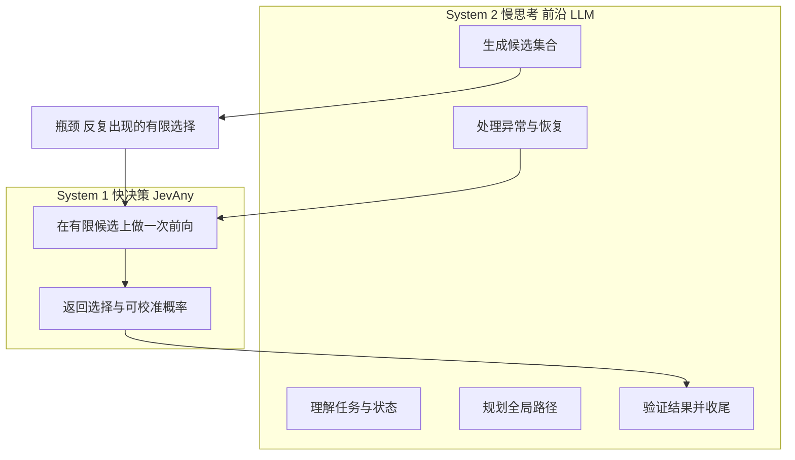
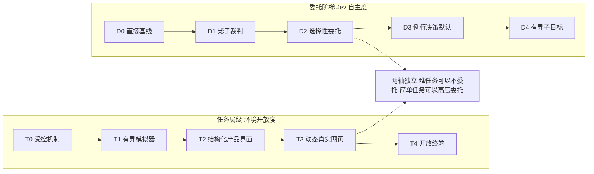
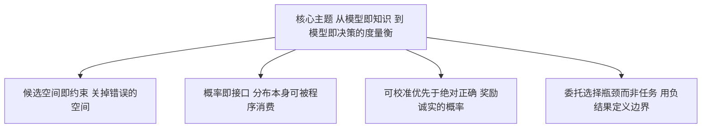
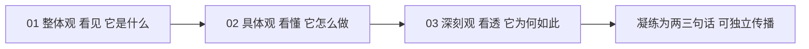

# 深刻观 · 哲学与升华

> 三观递进之三 —— **看透（Why It Must Be So）**
> 《整体观》给了你一张地图（它是什么、在哪里、怎么连）；《具体观》带你潜到水下，把 6 个技术点逐一拆开（它靠什么算法与工程实现）。本文是最后一跃：**跃出水面**，去看这套设计背后是否有一条**一以贯之的哲学**。
> 本文按"设计哲学 → 框架思想 → 核心主题"三层递进，最后凝练成**两三句话**，作为整个 trilogy 的认知结晶。读完本文，你不应只记住 JevAny 有哪些模块，而应理解**为什么它必须长成这样**。

---

## 一、总述：三个追问

前两篇回答的是"是什么"和"怎么做"。但如果只到这里，我们得到的是一堆堆砌的模块与技巧。真正的问题在下面三个追问里：

1. **为什么是 System 1？** 为什么要把"选择"单独做成一个模型，而不是继续让 LLM 生成答案再解析？
2. **为什么是委托？** JevAny 明明可以自己当"Agent"，为什么它的整个 Agent 协议反而在**约束自己去少管、少做**？
3. **为什么是概率？** 为什么它如此执着于"可校准的概率"，甚至宁愿牺牲一点准确率，也要让置信度诚实？

这三个追问，对应三个层次的答案：

- 第一个追问的答案，是**设计哲学**——把决策从推理中**剥离**（第二层）。
- 第二个追问的答案，是**框架思想**——把"能够选择"重新定义为"在约束内选择"，并把**委托的边界**当作第一等公民（第三层）。
- 第三个追问的答案，是**核心主题升华**——JevAny 提供的其实不是"一个更聪明的模型"，而是"一把度量不确定性的**尺子**"（第四层）。

下面逐层展开。作为预备，先看下面这张图：它用双系统（Dual-Process）的框架，把 JevAny 在整个智能回路里的位置一次说清。



*图 1：双系统分工概念图。上方是昂贵的 System 2（前沿 LLM）负责的所有"思考类"工作，下方是廉价的 System 1（JevAny）负责的唯一一件事——在有限候选上做一次前向选择。注意那条从 A4 指回 B1 的边：异常恢复之后，控制权仍然可以再次交给 Jev。这张图确立了本文所有讨论的原点：**分工，而非取代**。*

---

## 二、设计哲学：把"选择"从"推理"中剥离

### 2.1 双系统分工的工程落地

人类认知心理学里有一个经典划分（Kahneman, *Thinking, Fast and Slow*, 2011）：**System 1** 是快速、直觉、廉价的；**System 2** 是缓慢、费力、昂贵的。JevAny 把它翻译成了工程语言：

| 认知概念 | 工程对应 | 特征 |
|---|---|---|
| System 2 慢思考 | 前沿 LLM（Claude Opus / GPT-5.6-sol 等） | 规划、生成候选、恢复异常、验证完成；贵、慢、但会"想" |
| System 1 快决策 | JevAny（LoRA 适配后的主干 + 读出头） | 在**给定的**有限候选上做单次前向；便宜、快、但不"想" |

关键在于 JevAny 对 System 1 做了一个**极端的减法**：它不规划、不生成、不解释、不发明新选项。它只做一件事——**在别人给出的候选里选一个，并给出置信度**。前一篇《具体观》里的一切技巧（决策 token 打包、指针头、`option_isolation`、direct-token、软目标、RLCR、融合 kernel），本质上都是为了让"这一件事"做得**可控、可校准、够快**。

> 这就是第一个追问的答案：**为什么要把选择剥离出来？** 因为"选择"这件事的算力需求，"想"这件事的算力需求，数量级完全不同。让 System 2 去做选择是杀鸡用牛刀——不仅贵，而且它给出的置信度**不可校准**（一段自然语言的"我觉得是 B"里，没有概率）。把选择下沉为一个廉价的单次前向，是让两边都各得其所。

### 2.2 黄金法则：委托选择瓶颈，而非委托任务

如果非要为这套哲学挑一句"门训"，那就是仓库 README 里那句加粗的 **Golden Rules**（[README.md](file:///workspace/README.md#L57-L69)）：

> **Delegate the selection bottleneck, not the task.**
> —— 委托的是**选择的瓶颈**，而不是**任务本身**。

这一句话把 JevAny 的 Agent 协议的全部克制都解释清楚了。它意味着：Jev 的价值**只在一种情形下成立**——当 LLM 已经有了可行的全局策略，而剩下的工作里**反复出现低风险、可逆、且有多个真实备选**的选择。这与"让 Jev 接管任务"是**两件完全不同的事**。

为什么必须如此？因为 Jev 的机制决定了它**只能比较、不能发明**。技术报告把这称作"能力天花板"（capability ceiling）：如果前沿模型自己都没能想出正确的配置方案、数据库恢复算法或代码修改，那么"更好的局部选择"是**无济于事**的（[JevAny_Tech_Report_Agent_Harness_Appendix.md](file:///workspace/reports/JevAny_Tech_Report_Agent_Harness_Appendix.md#L175-L182)）。两个中等难度 Terminal-Bench 任务就是铁证：**命令替换率高达 74–79%**，成功率却**依然是 0%**，而且总开销还变大了。

### 2.3 委托的边界：用负结果定义的纪律

真正让这套哲学可信的，不是漂亮的成功案例，而是仓库**主动保留并公开**的负结果。最典型的是 v1 的 `regex-log` 过委托（over-delegation）事故（[AGENT_HARNESS_FRONTIER_PROTOCOL.md](file:///workspace/docs/experiments/AGENT_HARNESS_FRONTIER_PROTOCOL.md#L181-L188)）：

| 任务 | 结果 | 前沿调用 | token | 判定 |
|---|---|---|---|---|
| v1 `regex-log` | 两种模式 reward 都为 1 | **20 → 30** | **231,070 → 395,501** | 过委托失败 |
| v2 `regex-log` | 两种模式 reward 都为 1 | 14 → 12 | 159,509 → 147,212 | 有帮助 |
| v2 `sqlite-db-truncate` | 两种模式 reward 都为 1 | 15 → 17 | 152,107 → 268,907 | **同一个 harness，帮了一个任务却害了另一个** |

注意 v1 那一行的残酷之处：**质量没变（reward 都是 1），但成本暴涨了 71%**。这就是"委托率不是目标"的经验来源。于是仓库把这句话写进了协议：**Delegation coverage is a color/annotation, not an objective to maximize**（委托覆盖率只是一个标注，不是要最大化的目标）。

同样的纪律还体现在设计上：**fallback 是第一等公民**。当 Jev 输出畸形、服务失败、或置信度低于 **0.55**，harness 会执行 LLM 的备选（[附录 D.4](file:///workspace/reports/JevAny_Tech_Report_Agent_Harness_Appendix.md#L167-L173)）。委托不是"交出控制权"，而是"在可控风险内借用一次廉价判断"。

> 这才是第二个追问的答案：**为什么是委托，而且为什么如此克制？** 因为委托的价值是有条件的（conditional），不是普适的（universal）。JevAny 的全部协议设计，都是在**为"何时值得委托"划定一条可证伪的边界线**，而不是去追求"委托得越多越好"。

---

## 三、框架思想：四条隐含的第一性原理

如果说第二节是"为什么这样分工"，那么本节要问的是更深一层——**这套框架默认接受了哪几条第一性原理？** 我把它们归纳为四条，它们彼此咬合，共同解释了《具体观》里每一个技术取舍。

### 3.1 候选空间即约束（bounded choice as a constraint）

JevAny 从不在开放词表上"生成"，它只在一个**显式、有界、可枚举**的候选集上打分。这个约束看似是限制，实则是**全部可靠性的来源**：

- **不会输出非法答案**：direct-token 读头（[《具体观》技术点 3](file:///workspace/ReadCode/02-具体观-算法与实现剖析.md)）把候选映射为固定单 token 标签，数学上保证答案落在合法集合内。
- **顺序无关**：`option_isolation` 让每个选项成为独立子分支、共享位置 id，使决策**天然置换不变**——顺序偏置被结构性地消除。
- **边界不可伪造**：`user_tokens()` / `safe_text()` 在 tokenize 前把用户文本里的 `<|...|>` 改写成 `<¦...¦>`，保证调用者永远无法伪造分隔符。

换句话说，**约束不是要把模型变笨，而是要把"错误的空间"提前关掉**。这是 JevAny 与"生成式 Agent"最根本的分野。

### 3.2 概率即接口（probabilities as a first-class interface）

JevAny 的输出不是一段文本，而是一个**归一化分布**加一个**按机会修正过的置信度**。它的服务契约里，置信度公式是经过校准设计的（[API.md](file:///workspace/docs/API.md)）：

```text
choice:  (max_p − 1/K) / (1 − 1/K)      # K 为选项数，扣除"瞎猜也有 1/K"的机会
score:   1 − E[|level − mode|] / (L − 1) # 有序等级，按与众数的期望距离惩罚
```

为什么要把概率做成**接口**而不是"附带信息"？因为下游应用真正需要的是**动作**：

- 工单路由：读 `choice` 决定路由，读 `probabilities` 决定**是否需要人工复核**——
  这正是 [tool_routing.py](file:///workspace/examples/tool_routing.py) 的做法：低于阈值时返回 `"tool": null` 与 `"deferred": true`，把案子交还或继续追问（[INTEGRATIONS.md](file:///workspace/docs/INTEGRATIONS.md#L5-L22)）。
- Agent 委托：读置信度决定**是否回退给前沿**（阈值 0.55）。

一个可校准的概率，本身就是**一个可被程序消费的决策**。

### 3.3 可校准优先于绝对正确

这是 JevAny 最反直觉、也最值得学的一条。看几个"为了校准而牺牲一点正确"的证据：

- **温度缩放的定位**：温度只改 logits 的尺度，**不改变 argmax**（[《具体观》技术点 2](file:///workspace/ReadCode/02-具体观-算法与实现剖析.md)）。也就是说，它被设计成"**只改置信度，不改答案**"——校准是一等公民，准确率不动。
- **cell 里的取舍**：4B 上 direct-token 的 **JevBench 更好（80.95% vs 80.09%）**，而指针头在 **Transfer 略强（78.68% vs 78.20%）**。发布时同时保留两条读头，正是因为"没有单一指标能吃掉全部"——**诚实地承认权衡**，而不是粉饰。
- **RLCR 的诚实负结果**：RLCR 用 Brier 型奖励（`r = c − (q − c)²`，[Beyond Binary Rewards](https://arxiv.org/abs/2507.16806)，Damani et al., 2025）联合优化正确性与校准。结果：开发集 NLL 改善约 **0.005**，但**迁移精度未提升**。仓库把它作为默认发布之外的可选项，并在文档里**如实写出这个负结论**。

> 这一条的思想根源，是**严格适当评分规则（strictly proper scoring rule）**（[Gneiting & Raftery, 2007](https://doi.org/10.1198/016214506000001437)）：只有特定的评分规则，才会**奖励诚实的概率**。JevAny 把它从"评价指标"提升成了"训练目标"与"服务契约"。

### 3.4 度量与协议前置（pre-registration as a method）

最后一条容易被忽略，却是整套工程最"科学"的地方：**先冻结协议与样本，再看结果**。仓库的 Agent 协议里写着明确的发布规则（[AGENT_HARNESS_FRONTIER_PROTOCOL.md](file:///workspace/docs/experiments/AGENT_HARNESS_FRONTIER_PROTOCOL.md#L134-L147)）：

1. **冻结样本与协议，再看结果**；保留并展示**每一个**尝试过的格子，包括失败与中断。
2. 主结果需要**配对重复 + 不确定性区间**；单任务、单次尝试只能叫 **mechanism/demo**，永远不能叫 benchmark win。
3. 只在**同任务、同前沿模型、同检查点、同协议**内计算 Pareto 前沿。

甚至还解释了两个"为什么不再加量"的判断：**为什么 ALFWorld 不该被当作高难度终点**（它是 T1 有界模拟器，不是 T4 开放终端）；**为什么现在不该扩 WebArena**（后补任务会改变估计量、引入选择偏差）。这种"**主动限制自己刷分的空间**"的纪律，正是可复现性的前提。

下面这张图把"委托阶梯"与"任务层级"两条**互相独立**的轴并置，它是理解 3.1–3.4 四条原理如何落到协议上的总钥匙。



*图 2：委托阶梯 D0–D4 与任务层级 T0–T4 的两轴演进图。横向是环境开放度（任务有多难、多不可控），纵向是 Jev 自主度（委托有多深）。这张图的核心信息是——**两条轴互相独立**：一个 T4 的难题可以完全不委托，一个 T0 的简单题可以几乎全部委托。把实验"压扁"成一个"从易到难"的单轴，正是协议明确反对的做法。*

---

## 四、核心主题升华：从"模型即知识"到"模型即决策的度量衡"

现在可以回答第三个追问了。

过去十年，我们对模型的想象一直是"**模型即知识**"：一个模型知道得越多、答得越准，就越好。评测也围绕这个想象展开——准确率、通过率、榜单名次。JevAny 做的事情，悄悄换了一种想象：

> 它不试图**知道**更多，它试图**度量**得更准。
> 它输出的不是一个"答案"，而是一个**关于答案的分布**——一个把不确定的世界压缩成"可比较、可校准、可委派"的通用接口。

所以 JevAny 真正提供的东西，可以精确地称为一把**决策的度量衡（the measuring instrument of decisions）**：

- **可比较**：所有决策都被表示为有限候选上的分数，因此可以横向对照。
- **可校准**：置信度经过机会修正与严格适当规则训练，因此可以被信任地用于"要不要人工介入"这类下游判断。
- **可委派**：因为它有界、低风险、可回退，所以可以安全地嵌进一个会"想"的 Agent 循环里。

这也解释了为什么**"能力天花板"不是缺陷，而是定位**。一把尺子不需要会画图；它的价值在于**它测出来的读数是可信的**。JevAny 从不假装自己能修复一个缺失的全局计划——它只承诺：**当 LLM 已经想出可行的策略、而剩下的是反复的廉价选择时，它能把这一步做得又准又便宜。**

再看一层：这套哲学甚至重新定义了"自主性"。仓库里有一条非常漂亮的判断——**"很多候选不等于高自主"**。协议将决策意义分为 A0–A3（[附录 C](file:///workspace/reports/JevAny_Tech_Report_Agent_Harness_Appendix.md#L117-L127)）：A0 是"换个说法的同一个命令"（不该委托），A1 是"不同信息源或验证方式"（Jev 的主战场），A3 是"架构、精确编辑、凭据、破坏性操作"（永远留给前沿）。**真正的自主，是知道哪些决定不值得自己做。** 这大概是整份协议里最反直觉、也最深刻的一句话。



*图 3：核心洞见总结图。四条第一性原理（3.1–3.4）从同一个主题里生长出来，又各自回归这个主题。这张图值得反复回看——它就是本文的"浓缩版"。*

---

## 五、总结：三篇递进，收束为两三句话

回望整条认知路径：

- [01 整体观](file:///workspace/ReadCode/01-整体观-项目全貌解读.md)：**看见**——JevAny 是什么、站在生态哪里、八个层次如何协作、端到端怎么跑。
- [02 具体观](file:///workspace/ReadCode/02-具体观-算法与实现剖析.md)：**看懂**——决策重构、指针头、direct-token、软目标 SFT、RLCR、推理加速，每个点都有论文与代码。
- 03 深刻观：**看透**——为什么这一切必须长成这样。

三篇的关系，可以浓缩为下面这张收束图。



*图 4：三篇递进关系收束图。从"看见"到"看懂"再到"看透"，是一条不可逆的认知升级路径：地图 → 机理 → 洞见。最后那一步不产出新知识，只产出**理解**。*

### 终极凝练：两三句话

如果要让一个人在两分钟内记住 JevAny，只需要下面三句话：

> **一、JevAny 把"选择"从"推理"中剥离：LLM 负责想，Jev 负责选。**
>
> **二、它不生成答案，只把不确定的世界压缩成一个可校准、可比较、可委派的选择分布。**
>
> **三、所以它的边界不是智能的上限，而是委托的边界——委托的是选择的瓶颈，而不是任务本身。**

再压缩成一句口令，则是一句可独立传播的短句：

> **让强大的模型继续思考，让廉价的决策负责选择。**

---

## 附录 · 使用指南与案例（思辨型：何时该委托，何时不该）

> 本节不是"命令清单"（那在第 1、2 篇），而是**判断清单**——帮你把这套哲学用到自己的系统里。所有判定依据均来自仓库协议与负结果，非臆造。

### C.1 该不该委托：五问判定法

来自附录 D.1 的"合格决策"定义（[JevAny_Tech_Report_Agent_Harness_Appendix.md](file:///workspace/reports/JevAny_Tech_Report_Agent_Harness_Appendix.md#L131-L145)）。**五个问题全部为"是"，才值得委托**：

1. 这个选择是否**例行、局部可判、低风险、可逆**？
2. 菜单里是否有**至少两个**真实的、结论可观察的不同备选，且**正确项在其中**？
3. 当前观察信息是否**足以排序**这些备选？
4. 选错了能否**被检测并恢复**，而不破坏任务？
5. Jev 选择的成本，是否**低于**再问一次前沿模型？

**适合委托**：检查类命令、页面导航、等待 vs 轮询、编译、选择验证方式。
**永远留给前沿**：精确文件内容、架构策略、破坏性命令、安全敏感操作、最终完成判定。

### C.2 反面案例：三种"该不该委托"的误判

| 误判 | 现象 | 仓库存证 |
|---|---|---|
| **过委托** | 质量没变但成本暴涨 | v1 `regex-log`：calls 20→30，tokens 231,070→395,501 |
| **委托廉价任务** | 任务本身太简单，选择成本高于直接做 | Sokoban 多数格子 token 反而上升（calls −26.2%、tokens −122.0%，[formal-matrix.md](file:///workspace/results/agent-harness-v1/formal-matrix.md#L10-L17)） |
| **指望委托补能力** | 高替换率但成功率依旧为 0 | 两个中等 TB2 任务替换率 74–79%，success 仍 0% |

一句话记忆：**委托率不是目标；只有当"验证质量不下降、且总资源下降"时，委托才成立。**

### C.3 集成范式：三种把 Jev 接入程序的方式

| 范式 | 代码入口 | 适用场景 | 关键设计 |
|---|---|---|---|
| **HTTP / 进程内决策** | [JevClient.system_one](file:///workspace/examples/tool_routing.py) | 工单路由、分类、排序 | 用 `probabilities` 设阈值；低置信度返回 `deferred`，交还或追问 |
| **编译式 harness** | [examples/harness.py](file:///workspace/examples/harness.py)、[openai_compat.py](file:///workspace/jevany/openai_compat.py) | 让外部 LLM 把任务编译为定型问题 | state 由调用者掌握、原样传给 JevAny；planner 输出必须是 JSON |
| **符号决策树** | [examples/bedrock_symbolic.py](file:///workspace/examples/bedrock_symbolic.py) | 多分支、需可审计的流程 | LLM 写决策树、校验分支覆盖与无环、每个内部节点交给 Jev |

三种范式共享同一条契约：**给 `state` + 带候选的定型问题，回选择 + 概率**（`choice` / `noul` / `score` 三型）。

### C.4 企业落地检查表

把哲学变成可执行的上线前检查：

- [ ] 候选数为 **2–4 个**，且**正确项必在其中**；能提供**真实不同的证据或路径**（不是换个说法的同一个动作）。
- [ ] 动作**可逆**，或配有**低置信度回退**（阈值可参考 0.55，但应在你自己的留出集上标定）。
- [ ] 下游**真正消费概率**（如设复核阈值），而不是只用 argmax。
- [ ] 有**成对（paired）的 reward/成本**证据支持"这一刻值得委托"，而不是仅凭单次演示。
- [ ] 委托**范围有上限**：明确哪些决策（A3：架构、精确编辑、凭据、破坏性操作）**永远不交给 Jev**。

做到这五条，你就把"**委托选择瓶颈，而非委托任务**"从一句口号，落成了一条可以审计的工程纪律。

---

*(本文为三观递进之三·深刻观。本文所有事实与数字均来自仓库内真实文件：[README.md](file:///workspace/README.md)、[AGENT_HARNESS_FRONTIER_PROTOCOL.md](file:///workspace/docs/experiments/AGENT_HARNESS_FRONTIER_PROTOCOL.md)、[JevAny_Tech_Report_Agent_Harness_Appendix.md](file:///workspace/reports/JevAny_Tech_Report_Agent_Harness_Appendix.md)、[results/agent-harness-v1/formal-matrix.md](file:///workspace/results/agent-harness-v1/formal-matrix.md)、[INTEGRATIONS.md](file:///workspace/docs/INTEGRATIONS.md)。引用的论文均经检索核实；Kahneman 的双系统理论为背景框架说明，非仓库依赖。)*

---

## 校验记录

| 图 | 类型 | 状态 |
|---|---|---|
| 图 1 双系统分工概念图 | `flowchart TB` + `subgraph` | 通过 |
| 图 2 委托阶梯与任务层级两轴演进图 | `flowchart LR` + `subgraph` | 通过 |
| 图 3 核心洞见总结图 | `flowchart TB` | 通过 |
| 图 4 三篇递进关系收束图 | `flowchart LR` | 通过 |
